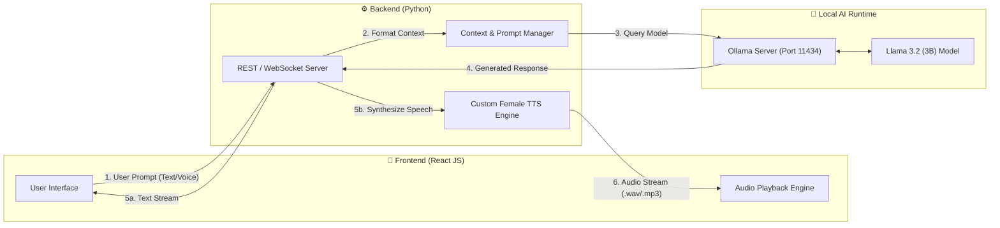

<div align="center">

# 🤖 ELO — Personal Desktop AI Assistant

### *Fast. Private. Voice-Enabled. 100% Local Intelligence.*

[](https://www.python.org/)
[](https://react.dev/)
[](https://ollama.com/)
[-0467DF?style=for-the-badge&logo=meta&logoColor=white)](https://ai.meta.com/)
[]()
[](LICENSE)

<p align="center">
  <b>ELO</b> is a next-generation, privacy-first desktop AI companion powered by a local <b>Llama 3.2 (3B)</b> engine, a high-performance <b>Python</b> backend, a sleek <b>React JS</b> interface, and expressive <b>custom female voice synthesis</b>.
</p>

[Features](#-key-features) •
[Architecture](#-system-architecture) •
[Tech Stack](#️-tech-stack) •
[Installation](#-a-to-z-installation--setup-guide) •
[Configuration](#️-configuration--customization) •
[Troubleshooting](#-troubleshooting--faq)

</div>

---

## 📌 Table of Contents

1. [Overview](#-overview)
2. [Why ELO?](#-why-elo)
3. [Key Features](#-key-features)
4. [System Architecture](#-system-architecture)
5. [Tech Stack](#️-tech-stack)
6. [System Requirements](#-system-requirements)
7. [Project Directory Structure](#-project-directory-structure)
8. [A-to-Z Installation & Setup Guide](#-a-to-z-installation--setup-guide)
9. [Running the Application](#️-running-the-application)
10. [Configuration & Customization](#️-configuration--customization)
11. [API & Communication Flow](#-api--communication-flow)
12. [Troubleshooting & FAQ](#-troubleshooting--faq)
13. [Roadmap](#️-roadmap)
14. [Contributing](#-contributing)
15. [License & Author](#-license)

---

## 📖 Overview

**ELO** is a personal desktop AI assistant built to deliver a seamless, intelligent, and lifelike conversational experience directly on your local machine. Unlike cloud-dependent assistants that send your private conversations to remote servers and charge per token, ELO leverages **Ollama** and Meta's **Llama 3.2 (3B)** model to run completely offline.

Paired with a responsive **React JS** desktop interface, a modular **Python** backend, and a **custom-tuned female Text-to-Speech (TTS)** pipeline, ELO bridges the gap between raw local LLM power and an intuitive, everyday companion.

---

## 💡 Why ELO?

| Feature | Cloud AI Assistants | **ELO (Local AI Assistant)** |
| :--- | :---: | :---: |
| **Data Privacy** | ❌ Sent to third-party servers | ✅ **100% Local & Private** |
| **Subscription / API Cost** | ❌ Monthly fees / Pay-per-token | ✅ **100% Free Forever** |
| **Offline Capability** | ❌ Requires active internet | ✅ **Works Completely Offline** |
| **Voice Personality** | ⚠️ Generic system voices | ✅ **Custom Natural Female Voice** |
| **Customization** | ❌ Locked ecosystem | ✅ **Full Open-Source Control** |

---

## ✨ Key Features

* 🔒 **100% Offline & Privacy-First:** Powered locally by Ollama and Llama 3.2 (3B). Zero telemetry, zero cloud logging, and zero API keys required.
* ⚡ **Ultra-Low Latency Inference:** The lightweight 3-billion parameter model is specifically optimized for consumer hardware, delivering fast token generation on both GPU and CPU.
* 🎙️ **Custom Female Voice Synthesis (TTS):** Features an integrated audio synthesis pipeline that converts ELO's text responses into natural, expressive female speech in real time.
* 🎨 **Modern React Desktop UI:** Clean, distraction-free user interface with smooth animations, real-time streaming responses, voice waveform/status indicators, and chat history.
* 🧠 **Contextual Memory & Persona:** Maintains conversational context across turns with a customizable system prompt tailored for helpful, concise, and natural spoken responses.
* 🧩 **Modular Python Architecture:** Clean separation between the LLM handler, TTS audio engine, and API controller—making it effortless to extend with new tools, skills, or models.

---

## 🏗️ System Architecture

ELO follows a decoupled, event-driven client-server architecture running locally on your machine:



---

## 🛠️ Tech Stack

| Layer | Technology | Role in ELO |
| :--- | :--- | :--- |
| **Frontend UI** | React JS, HTML5, CSS3, JavaScript (ES6+) | Interactive desktop interface, chat rendering, and state management |
| **Backend Core** | Python 3.10+ | Core application logic, API routing, and process orchestration |
| **LLM Runtime** | Ollama | Local LLM hosting and hardware-accelerated model execution |
| **AI Model** | Meta Llama 3.2 (`llama3.2:3b`) | Fast, conversational 3B parameter language model |
| **Voice Engine** | Python TTS Pipeline (Custom Female Voice) | Real-time Text-to-Speech synthesis and audio output management |

---

## 💻 System Requirements

Because ELO runs the Llama 3.2 (3B) model locally on your machine, ensure your system meets the following specifications:

| Component | Minimum Specification | Recommended Specification |
| :--- | :--- | :--- |
| **OS** | Windows 10/11, macOS 12+, or Linux (Ubuntu 20.04+) | Windows 11 / macOS (Apple Silicon) / Ubuntu 22.04+ |
| **RAM** | 8 GB System RAM | 16 GB+ System RAM |
| **GPU / VRAM** | CPU-only supported (Modern Multi-Core CPU) | NVIDIA GPU (4GB+ VRAM) or Apple M1/M2/M3/M4 |
| **Storage** | 4 GB free disk space (for model + dependencies) | 10 GB+ SSD space |
| **Runtime** | Python 3.10+, Node.js 18+, Ollama | Latest stable versions |

---

## 📂 Project Directory Structure

```text
ELO/
├── backend/                     # Python backend & AI/TTS orchestration
│   ├── main.py                  # Main backend server entry point
│   ├── llm_engine.py            # Ollama / Llama 3.2 (3B) communication handler
│   ├── tts_engine.py            # Custom female voice synthesis & audio pipeline
│   ├── config.py                # Model parameters, system prompts & ports
│   └── utils/                   # Helper functions, logging & audio utilities
├── frontend/                    # React JS desktop user interface
│   ├── public/                  # Static assets, icons & index.html
│   ├── src/
│   │   ├── components/          # Chat window, voice visualizer & controls
│   │   ├── services/            # API/WebSocket communication with Python backend
│   │   ├── styles/              # Modern UI styling & animations
│   │   ├── App.jsx              # Root React component
│   │   └── main.jsx             # React DOM entry point
│   ├── package.json             # Frontend dependencies & build scripts
│   └── .env.example             # Frontend environment configuration template
├── models/                      # Custom voice files / Ollama Modelfile configs
├── requirements.txt             # Python backend dependencies
├── .gitignore                   # Ignored files and build artifacts
├── LICENSE                      # MIT License
└── README.md                    # Complete project documentation
```

*(Note: File names inside `backend/` and `frontend/` may vary slightly depending on your current branch version.)*

---

## 🚀 A-to-Z Installation & Setup Guide

Follow these step-by-step instructions to get **ELO** up and running on your system from scratch without any bugs.

### Step 1: Install Prerequisites

1. **Install Python (3.10 or higher):**
   * Download from [python.org](https://www.python.org/downloads/).
   * ⚠️ *Important (Windows):* Check the box **"Add Python to PATH"** during installation.
2. **Install Node.js (v18 or higher):**
   * Download the LTS version from [nodejs.org](https://nodejs.org/).
3. **Install Ollama:**
   * Download and install Ollama for your OS from [ollama.com](https://ollama.com/download).

---

### Step 2: Clone the Repository

Open your terminal (Command Prompt, PowerShell, or Bash) and run:

```bash
git clone https://github.com/nandanshanto/ELO.git
cd ELO
```

---

### Step 3: Set Up Ollama & Pull Llama 3.2 (3B)

Make sure the Ollama application is running in the background, then download the **Llama 3.2 (3B)** model (~2.0 GB):

```bash
# Verify Ollama is installed
ollama --version

# Pull the Llama 3.2 3B model
ollama pull llama3.2:3b

# (Optional) Test the model in terminal to verify it works
ollama run llama3.2:3b "Hello ELO!"
```

---

### Step 4: Set Up the Python Backend

Create an isolated virtual environment and install all required Python packages:

```bash
# 1. Create a virtual environment in the project root
python -m venv venv

# 2. Activate the virtual environment
# On Windows (Command Prompt):
venv\Scripts\activate
# On Windows (PowerShell):
.\venv\Scripts\Activate.ps1
# On macOS / Linux:
source venv/bin/activate

# 3. Upgrade pip and install dependencies
pip install --upgrade pip
pip install -r requirements.txt
```

---

### Step 5: Set Up the React Frontend

Open a new terminal inside the project directory and install the Node modules:

```bash
# Navigate to the frontend folder (or stay in root if package.json is in root)
cd frontend

# Install all frontend packages
npm install
```

---

## ▶️ Running the Application

To run **ELO**, you will need **Ollama** active in the background and two terminal tabs (one for the Python Backend and one for the React Frontend).

### 1. Ensure Ollama is Running
By default, Ollama runs automatically as a background service on `http://localhost:11434`. If it isn't running, start it with:
```bash
ollama serve
```

### 2. Start the Python Backend
In **Terminal 1** (with your Python virtual environment activated):
```bash
# From the root or backend directory
python main.py
# Or if located inside backend/:
python backend/main.py
```
*The backend server will initialize the Llama 3.2 connection and load the custom female TTS voice model.*

### 3. Start the React UI
In **Terminal 2** (inside your frontend directory):
```bash
npm start
# Or if using Vite:
npm run dev
```
*The desktop interface will launch automatically in your browser or desktop wrapper (typically at `http://localhost:3000` or `http://localhost:5173`).*

---

## ⚙️ Configuration & Customization

You can easily customize ELO's intelligence, personality, and voice settings.

### 1. Customizing ELO's Personality (System Prompt)
Want ELO to be more witty, professional, or concise? You can create a custom Ollama `Modelfile` or edit the system prompt in the Python backend:

```dockerfile
# Example Modelfile for ELO
FROM llama3.2:3b

PARAMETER temperature 0.7
PARAMETER top_p 0.9

SYSTEM """
You are ELO, an intelligent, warm, and highly capable personal desktop AI assistant created by Nandan Das Shanto. 
Keep your responses clear, natural, and optimized for spoken voice output. Avoid overly long markdown lists unless asked.
"""
```
To register your custom ELO model in Ollama:
```bash
ollama create elo-assistant -f ./Modelfile
```

### 2. Adjusting the Female Voice Synthesis (TTS)
Inside the backend TTS configuration, you can fine-tune:
* **Voice ID / Model:** Switch between available female neural voices.
* **Speech Rate:** Increase or decrease speaking speed (e.g., `1.0x` to `1.15x`).
* **Pitch & Volume:** Adjust audio warmth and output gain.

### 3. Environment Variables (`.env`)
If you want to customize ports or host URLs, create a `.env` file in the root/backend directory:
```env
OLLAMA_HOST=http://127.0.0.1:11434
LLM_MODEL=llama3.2:3b
BACKEND_PORT=8000
ENABLE_VOICE_TTS=True
```

---

## 🔌 API & Communication Flow

The Python backend exposes clean endpoints for the React frontend to interact with:

| Method | Endpoint | Description |
| :--- | :--- | :--- |
| `GET` | `/api/health` | Checks if the Python backend and Ollama runtime are online |
| `POST` | `/api/chat` | Sends user prompt to `llama3.2:3b` and returns text + audio response |
| `POST` | `/api/tts` | Converts arbitrary text into custom female speech audio |
| `POST` | `/api/reset` | Clears current conversation memory/context |

### Example Request (`POST /api/chat`)
```json
{
  "message": "Hey ELO, what's on my schedule for today?",
  "voice_enabled": true
}
```

### Example Response
```json
{
  "status": "success",
  "reply": "Good afternoon! Ready to tackle your tasks today. What would you like to prioritize first?",
  "model": "llama3.2:3b",
  "audio_url": "/static/audio/response_01.wav"
}
```

---

## 🛠️ Troubleshooting & FAQ

<details>
<summary><b>1. Error: "Connection refused to localhost:11434" (Ollama not responding)</b></summary>

* **Cause:** The Ollama background service is not running, or the model hasn't been downloaded yet.
* **Fix:**
  1. Run `ollama serve` in a terminal or open the Ollama desktop app.
  2. Ensure the model is downloaded by running `ollama list`. If `llama3.2:3b` is not listed, run `ollama pull llama3.2:3b`.
</details>

<details>
<summary><b>2. Voice / Audio is not playing in the React UI</b></summary>

* **Cause:** Browser autoplay policies block audio until the user interacts with the page, or a Python audio library is missing.
* **Fix:**
  1. Click anywhere inside the ELO interface before sending a message.
  2. Check the Python terminal for any TTS errors and ensure all dependencies in `requirements.txt` are installed inside your active `venv`.
</details>

<details>
<summary><b>3. CORS Error between React Frontend and Python Backend</b></summary>

* **Cause:** The frontend port doesn't match the allowed origins in the backend.
* **Fix:** Make sure CORS middleware is enabled in your Python server (`allow_origins=["*"]` for local development) and that the frontend is pointing to the exact backend URL (`http://localhost:8000` or `http://localhost:5000`).
</details>

<details>
<summary><b>4. Slow Response Times from Llama 3.2 (3B)</b></summary>

* **Cause:** Your system may be running low on available RAM/VRAM or running in power-saving mode.
* **Fix:** Close heavy background tabs, plug in your laptop charger, and verify with `ollama ps` whether the model is offloading to GPU or CPU.
</details>

---

## 🗺️ Roadmap

- [x] Local LLM integration with **Llama 3.2 (3B)** via Ollama
- [x] Custom Female Voice Synthesis (TTS) pipeline
- [x] Modern React JS Desktop Interface
- [ ] **Wake-Word Detection ("Hey ELO")** & continuous Speech-to-Text (STT) microphone input
- [ ] **OS Automation & System Control** (Opening apps, taking screenshots, media control)
- [ ] **Long-Term Vector Memory (RAG)** for remembering user preferences across sessions
- [ ] **One-Click Desktop Installer** (`.exe` / `.dmg` via Electron or Tauri)

---

## 🤝 Contributing

Contributions make the open-source community an amazing place to learn, inspire, and create! Any contributions you make are **greatly appreciated**.

1. **Fork** the repository (`https://github.com/nandanshanto/ELO/fork`)
2. **Create** your Feature Branch:
   ```bash
   git checkout -b feature/AmazingFeature
   ```
3. **Commit** your Changes:
   ```bash
   git commit -m "feat: add AmazingFeature"
   ```
4. **Push** to the Branch:
   ```bash
   git push origin feature/AmazingFeature
   ```
5. **Open** a Pull Request!

---

## 📝 License

Distributed under the **MIT License**. See the [`LICENSE`](LICENSE) file for more information.

---

<div align="center">

### 👨‍💻 Author & Maintainer

**Nandan Das Shanto**  
[](https://github.com/nandanshanto)

*If you like **ELO**, please consider giving this repository a ⭐ **Star** on GitHub!*

</div>